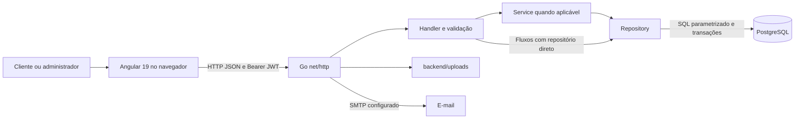

# 01 — Arquitetura

## Três responsabilidades distintas

Angular executa a apresentação no navegador: renderiza catálogo, mantém formulários e mostra estados de carregamento. A API Go recebe requisições, identifica o usuário, valida regras e coordena a persistência. PostgreSQL guarda os registros e aplica integridade, inclusive quando duas requisições chegam ao mesmo tempo. O frontend não acessa o banco diretamente.

Não há Fiber nem Gorilla no roteamento atual. `backend/src/main.go` monta `http.NewServeMux`, injeta dependências e registra as rotas. A configuração Angular atual produz aplicação de navegador; arquivos de configuração SSR remanescentes não significam que SSR esteja ativado no build.

## Exemplo concreto de requisição

Na listagem, `ProductService.getProductsPage` chama `PaginationService.getPage`, que envia filtros, offset e limite para `GET /products`. `routes/products.go` encaminha ao handler de produtos, que chama o serviço e o repository. A consulta retorna itens e metadados. O Angular atualiza a grid e a paginação compartilhada, sem carregar todo o catálogo para simular paginação local.

No checkout, o caminho é mais direto: `CheckoutComponent` envia `POST /checkout`, o middleware valida o JWT e `CheckoutHandler` usa `CheckoutRepository`. Esse repository precisa controlar a transação inteira de leitura de carrinho, validação de frete, baixa de estoque, gravação do pedido e limpeza do carrinho. Não seria correto inventar uma camada de serviço inexistente para explicar o diagrama.

## Organização física

`frontend/src/app/core` concentra autenticação, HTTP, guards e serviços transversais. `features` contém funcionalidades públicas e formulários extensos. `components/admin` contém telas administrativas e rotas do painel. `shared` reúne contratos, componentes reutilizáveis, validações e utilitários. Os tipos foram organizados por produtos, promoções, pedidos, checkout, API e UI, mantendo reexportações para compatibilidade.

No Go, `routes` registra o contrato HTTP, `handlers` trata entrada/saída, `services` concentra regras e integrações quando apropriado e `repositories` executa SQL. `models` contém estruturas compartilhadas; structs privadas de uma consulta podem permanecer junto ao repository. Essa organização é em camadas dentro de uma aplicação, não um conjunto de microsserviços.

## Decisões e implantação

Angular fornece formulários e composição de UI; Go oferece servidor HTTP e controle explícito de erros; PostgreSQL fornece relações, constraints e transações. Essas são justificativas técnicas compatíveis com o código, não prova de que foram as únicas razões históricas da escolha.

Em desenvolvimento, os endereços usuais são frontend 4200 e API 8080. Nos E2E, o navegador acessa a build em 4206 e um servidor isolado em 8086. O redirecionamento de API no contexto de teste não altera a configuração comercial. Uma implantação real exigiria HTTPS, configuração de origem/API, proteção operacional de segredos e estratégia de armazenamento de uploads.

Consulte [Go](03_BACKEND_GO.md), [banco](04_BANCO_DE_DADOS.md) e o [mapa](11_MAPA_DE_ARQUIVOS.md).
