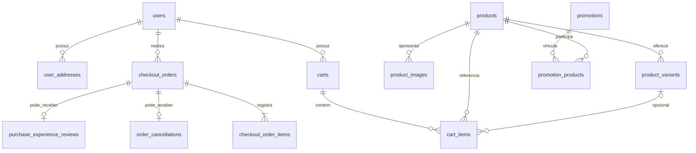

# 04 — PostgreSQL e integridade

## Relações principais

Tabelas relacionam entidades por chaves primárias e estrangeiras. O ID interno identifica a linha; SKU é identificação externa da loja e não substitui a chave primária.

`brands` e `product_types` classificam produtos; `favorites` relaciona usuário e produto. `shipping_ranges` configura entrega. O diagrama resume o negócio e não enumera tabelas auxiliares de rastreabilidade de seeds/migrations. `checkout_order_items` mantém dados históricos da compra além dos relacionamentos.

## Dinheiro sem perda de centavos

Preços do catálogo e variantes usam valores decimais SQL. Não é correto afirmar que todas as colunas de preço são inteiras. No checkout, frete, totais e preços congelados são tratados em centavos inteiros (`Money`, `*_cents`), evitando soma com ponto flutuante na regra financeira. A API serializa dinheiro para exibição e o Angular usa formatação monetária.

O total é subtotal original menos desconto aplicável mais frete. A migration 51 acrescentou os campos históricos de entrega, prazo, modalidade, subtotal e desconto. Pedidos antigos continuam com informação ausente em campos que não eram registrados; NULL não significa frete grátis e não autoriza recalcular o pedido com tarifas atuais.

A migration 53 acrescenta `installments smallint`. NULL representa pedido histórico sem plano registrado. Cartão aceita 1–6; Pix/boleto aceitam 1. O valor de cada parcela é derivado do total imutável: para 22,91 em seis, cinco parcelas de 3,82 e uma de 3,81. A soma é exatamente 22,91. Não são criadas cobranças bancárias.

## JSONB e snapshots

Características técnicas usam JSONB em `products.measurements`. Isso permite atributos diferentes para travesseiro, edredom ou toalha sem uma coluna para cada propriedade. Dados que exigem relacionamento e estoque, como variantes, permanecem em tabela própria. Não se usa o campo de texto Tamanho para substituir variantes comerciais.

O endereço do pedido é um snapshot JSONB: alterar um endereço salvo depois não reescreve o destino histórico da compra. Nome e preço unitário do item também são congelados. Snapshot não elimina chaves estrangeiras; preserva o significado da transação diante de futuras edições do catálogo.

## Constraints e concorrência

Chaves estrangeiras impedem referências inexistentes. UNIQUE protege SKU e a avaliação por pedido; CHECK valida intervalos como parcelas. As faixas de CEP ativas têm proteção contra sobreposição. Índices de unicidade também ajudam a busca, mas um índice não substitui validação comercial.

O checkout mantém bloqueios e transação para não vender acima do saldo. Cancelar registra motivo/evento e repõe o estoque uma única vez. Produto com histórico comercial não deve ser removido fisicamente: o fluxo administrativo prefere arquivamento/desativação. Apagar em cascata pedidos para permitir uma exclusão seria incorreto.

## Migrations e rollback

`backend/migrations` documenta evolução incremental. A 13 criou variantes; a 48 introduziu SKU externo; a 50 concluiu suporte necessário ao CRUD; a 51 registra frete. A 52 torna critérios auxiliares antigos de avaliação opcionais, mantendo nota geral obrigatória. A 53 adiciona parcelamento; a 54 separa avaliações de produto da experiência da compra.

Estado principal confirmado na auditoria Angular: **54, dirty=false**. As 52/53 foram aplicadas na implantação autorizada; a 54 cria product_reviews. A 55 permanece pendente. O down da 52 recusa reimpor NOT NULL quando avaliações simplificadas perderiam compatibilidade. O down da 53 recusa apagar a coluna quando planos já foram gravados. Rollback seguro pode, portanto, interromper com erro deliberado em vez de apagar histórico financeiro.

Nunca edite migrations já aplicadas para corrigir dados. Prepare uma incremental, faça backup e obtenha autorização quando o destino for o principal. Os testes desta entrega não alteraram preços, estoques, pedidos ou campanhas do principal.

Avaliações de produto mantêm vínculo com usuário/produto, elegibilidade por compra aprovada, edição pelo proprietário e agregação real. Não se convertem avaliações antigas de experiência em notas de produto. Nenhuma migration principal foi executada nesta revisão documental.

## Arquivos e backup

product_images guarda caminhos, não bytes. pg_dump sozinho não restaura fotografias: combine backup de banco com cópia coerente do UPLOAD_DIR e inventário de hashes. O ZIP legado versionado cobre só parte das imagens atuais. Remoção de vínculo de galeria não apaga automaticamente arquivo físico; candidatos exigem revisão de referências indiretas, sem exclusão automática. Inventário atual no AUDITORIA_FINAL.md.
